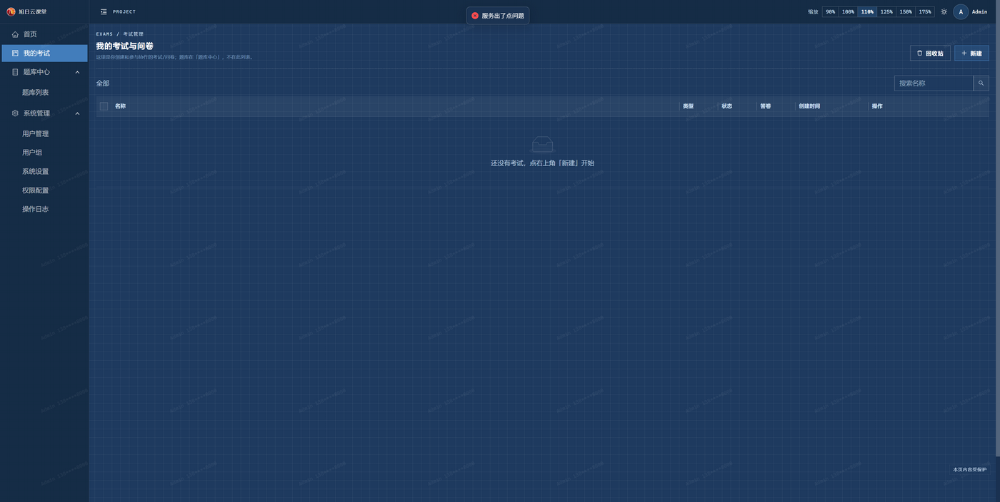
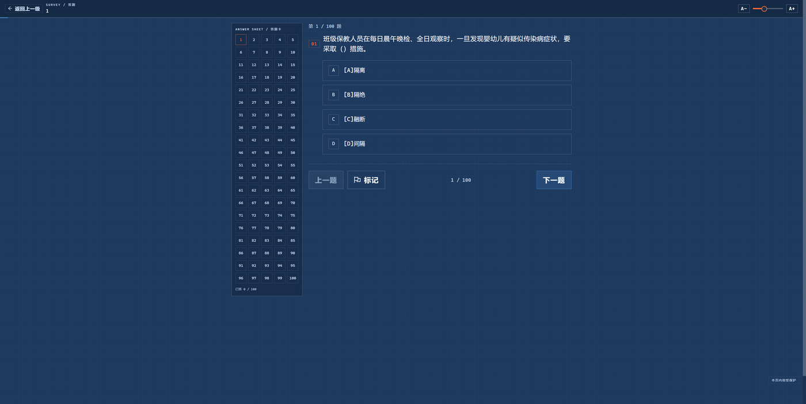
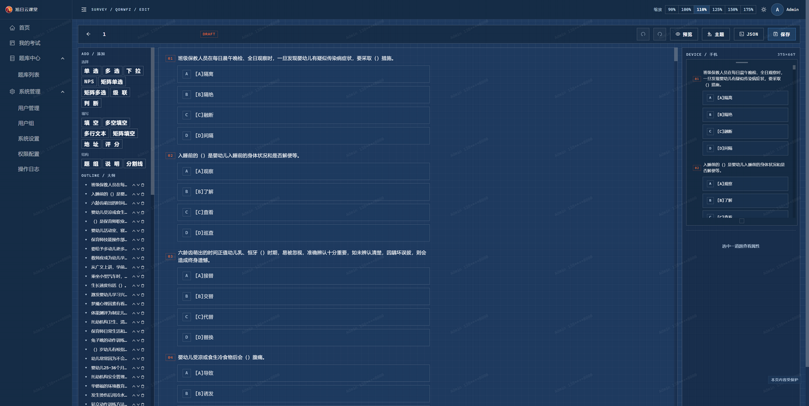
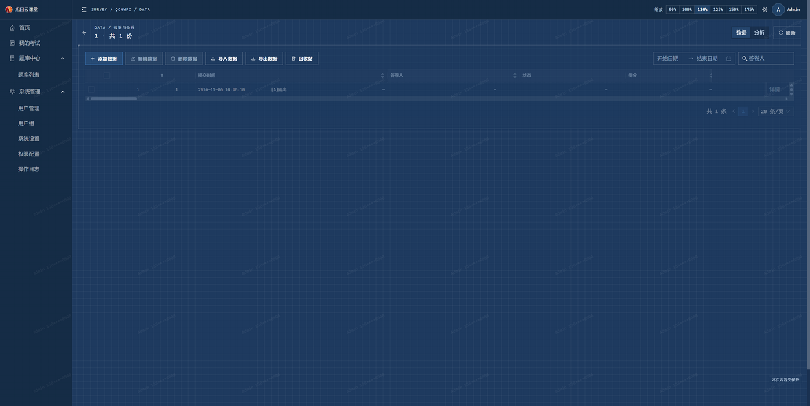
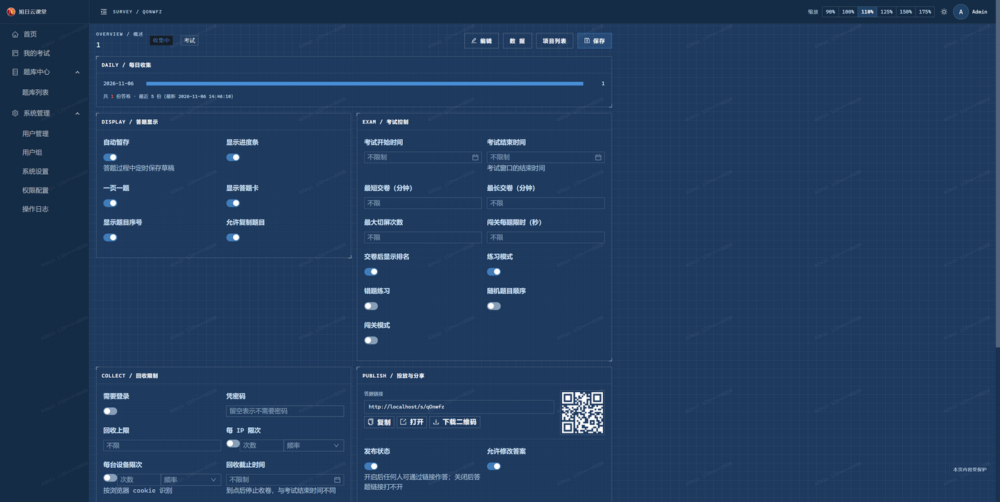
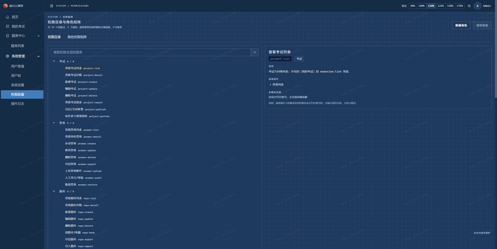

# 考试与学习平台

面向职业技能培训场景的一体化考评系统：出卷、组卷、答题、判分、数据分析，以及题库管理与练习。

蓝图/工程制图风格界面，圆角 0、无渐变，支持深浅两套主题与 90%～175% 六档字号缩放（照顾年长学员）。

---

## 界面预览

**考试与试卷管理** —— 一条主线看清「谁在考、考了多少、还差什么」：



**在线答题** —— 一页一题 / 瀑布流自动切换，答题卡、标记、字号调节、倒计时与切屏限制齐备：



**可视化出卷** —— 拖拽式题型面板，题干与选项直接编辑，支持题组、规则跳转与批量设置：



**答卷数据与统计** —— 逐份查看、导出 Excel、批量评分，分析并入同一页面：



**发布设置** —— 显示、考试控制、回收限制、投放分享集中在一页，不用来回跳：



**权限配置** —— 权限点按功能分组，按角色勾选，超级管理员只读保护：



---

## 功能

### 考试

- **建卷**：空白建卷、手工加题、从题库组卷
- **组卷**：选择题库，按题型配置题数与每题分值，实时汇总总题数与总分，一键抽题成卷
- **题型**：单选、多选、判断、填空、多空填空、评分、NPS、矩阵（单选/多选/填空）、级联、地址、多行文本等 14 种
- **答题**：一页一题或滚动模式，答题卡、进度条、必填校验、交卷二次确认
- **考试控制**：起止时间、限时倒计时、切屏检测、禁止提前交卷、随机题目顺序、闯关模式
- **判分与结果**：自动判分、成绩单、排名、逐题答案与解析

### 问卷

- 报名收集、满意度调查、信息登记
- 支持密码访问、登录后填写、提交后跳转、修改已有答案

### 题库

- 按专业 / 等级 / 课程分类管理
- Excel 导入导出（按题型分 sheet）
- 题目增删改查：题干、选项、正确答案、分值、解析、标签
- 组卷时按题型随机抽取，支持按用户组（班级）授权可见范围

### 练习

- 学员按题库刷题，记录练习进度
- 错题自动收集到笔记，可逐条查看和补充笔记

### 数据与统计

- 答卷以电子表格呈现，支持筛选、排序、编辑、补录、导入导出、回收站
- 逐题统计：选项分布、答题人数、正确率
- 图表支持条形 / 柱形 / 扇形切换
- 答卷与统计数据可导出 Excel

### 账号与权限

| 角色 | 权限范围 |
|---|---|
| 管理员 | 账号管理、用户组、系统设置、全部考试与题库 |
| 教师 | 建卷、组卷、管理题库、查看答卷与统计 |
| 学员 | 按班级可见的题库、练习、答题、查看自己的成绩 |

- 题库按用户组授权，组员自动继承，新成员加入即可见
- 菜单与页面按权限显示，越权访问直接拦在页面级

### 使用体验

- 桌面端侧栏导航，手机端底部标签栏，列表在手机上自动切换为卡片
- 亮色 / 暗色双主题，可随时切换
- 答题页字号可调（0.9×–2.0×），适合不同年龄学员
- 答题过程自动暂存，中断后可从上次位置继续

## 技术栈

| 层 | 技术 |
|---|---|
| 前端 | React 18 + TypeScript + Ant Design 5 + Vite，自行开发 |
| 后端 | Spring Boot 2.7 + MyBatis-Plus + MySQL 8 + Undertow |
| 部署 | 前端静态资源 + 后端单体服务，支持 nginx 反向代理 |

## 快速开始

前置：JDK 8、MySQL 8、Node.js 18+

```bash
# 1. 启动 MySQL（脚本内路径按需修改）
scripts/dev/start-mysql.ps1

# 2. 构建并启动后端（内部端口 7007，前端反向代理过去）
cd server
./gradlew :api:bootJar -x test
cd ..
scripts/dev/start-backend.ps1        # 也可 -Port 8080 换端口

# 3. 启动前端（对外 80，/api 代理到后端 7007）
cd client
npm install
npm run dev
```

访问方式：

- 管理后台：`http://localhost`
- 答题链接：`http://<主机IP>/s/<项目ID>`
- 默认账号：`admin` / `123456`（首次登录后请修改）

> 端口约定：**开发态前端占 80，后端内部 7007**，用户只需要记一个地址。
> 生产态（Docker）容器内 nginx 仍监听 80，但**宿主机默认发布到 9527**（四位数，避开服务器上常见的 80/8080/3000），
> 改 `.env` 的 `APP_PORT` 即可。后端任何情况下都不对外暴露。
> 后端换端口时改 `scripts/dev/start-backend.ps1 -Port`，并让 `VITE_API_TARGET` 指过去。
>
> Docker 首次部署前，必须在 `.env` 中设置 `SK_CRYPTO_KEY`（Base64 编码的 32 字节随机密钥）。
> 可运行 `scripts/dev/add-dept-authority.sql` 为已有数据库增加组权限列；新库已包含该结构。
> 启动后以管理员登录，调用 `GET /api/system/crypto/status` 检查 `templatesPlain/projectsPlain/answerSnapshotsPlain`，
> 并通过 `POST /api/system/crypto/migrate` 加密所有历史题目、项目 schema 和答卷随机卷快照。**密钥丢失会导致数据无法解密，必须离线备份，不能提交到 Git。**

## 目录结构

```
client/            前端
  src/pages/       页面：首页 / 考试 / 题库 / 练习 / 系统管理
  src/renderer/    题型渲染器
  src/designer/    问卷设计器（大纲、属性面板、规则编辑器）
  src/schema/      数据结构与规则引擎
server/            后端
  api/             REST 接口
  rdbms/           业务实现与数据访问
  shared/          公共模型与工具
scripts/dev/       本地启动、数据导入、SQL 脚本
```

## 许可

本项目采用 MIT 协议，详见 [LICENSE](LICENSE)。
